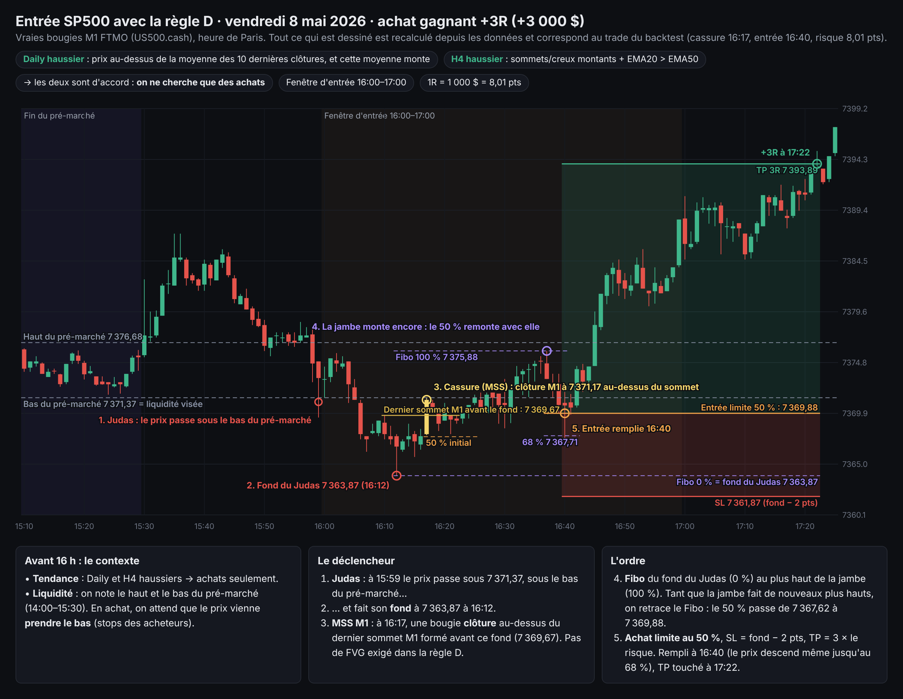
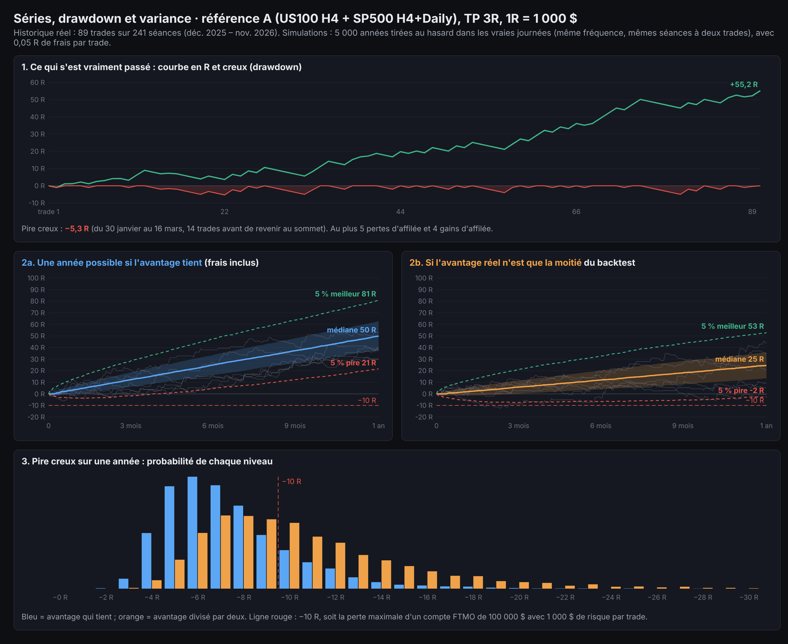
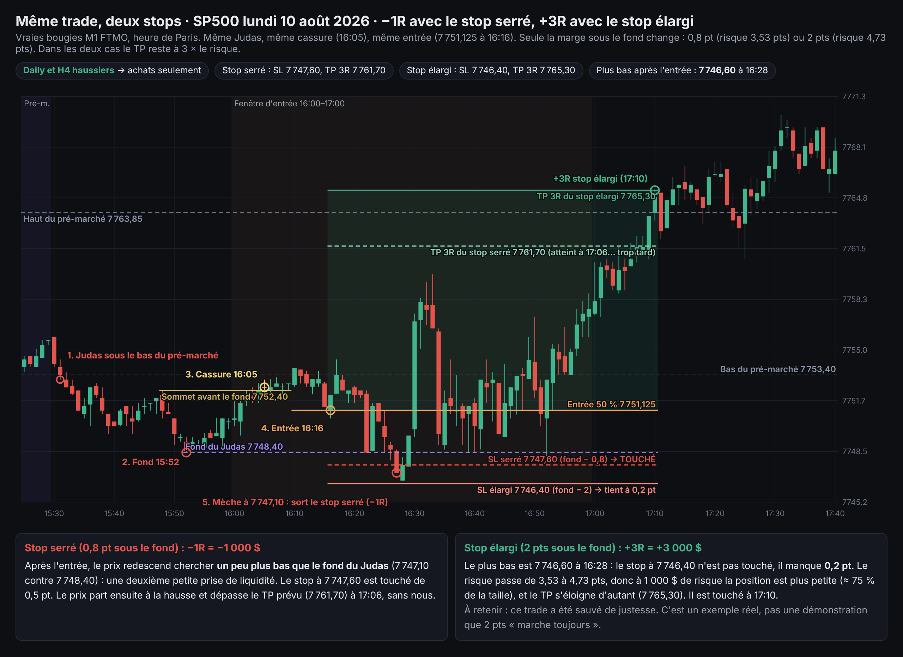

# Backtests Desk US — US100 et SP500 (session US, entrées M1)

*Mis à jour le 26 novembre 2026 (avec le test de tendance H1).*

Données : vraies bougies M1 de FTMO (US100.cash et US500.cash), exportées par le robot MT5 `DeskUS_Bridge` 1.04. La période va du **22 décembre 2025 au 25 novembre 2026**, soit 241 jours de bourse.

**Risque fixe de 1 000 $ par trade.** L'objectif (TP) est un multiple du risque : 2R = +2 000 $, 2,5R = +2 500 $, 3R = +3 000 $. Une perte au stop vaut toujours −1 000 $.

Les heures sont données en **heure de New York**, car l'ouverture est toujours à 9:30 NY. À Paris, cela fait 15:30 la plupart de l'année, mais 14:30 pendant les semaines où les États-Unis et l'Europe ne changent pas d'heure le même jour. En 2026, ce sont les semaines du 9 au 27 mars et du 26 au 30 octobre.

---

## 1. La règle d'entrée (commune aux deux indices)

1. **Tendance** : on ne prend que le sens donné par le filtre de tendance de l'indice (voir section 2).
2. **Liquidité** : on note le haut et le bas du **pré-marché** (8:00–9:30 NY).
3. **Judas** : après 9:30, le prix doit passer au-delà de ce niveau : sous le bas pour un achat, au-dessus du haut pour une vente. Le point extrême atteint s'appelle le « fond du Judas » (ou le « sommet » pour une vente).
4. **Cassure (MSS) M1** : une bougie M1 **clôture** au-delà du dernier sommet M1 formé avant le fond du Judas (le dernier creux pour une vente). Ce sommet est un pivot de 2 bougies de chaque côté.
5. **Fibonacci** : on le trace du fond du Judas (0 %) au plus haut de la jambe (100 %). Tant que la jambe fait de nouveaux plus hauts, on le retrace.
6. **Ordre limite au 50 %**. Stop = fond du Judas − marge. TP = 2R, 2,5R ou 3R du risque.
7. L'ordre doit être rempli **entre 10:00 et 11:00 NY** (16:00–17:00 Paris). On sort à 13:00 NY si ni le stop ni le TP n'ont été touchés.
8. Un seul trade par indice et par jour : le premier setup valide.

## 2. Règles retenues par indice

| | US100 | SP500 |
|---|---|---|
| Filtre de tendance | H4 | H4 **et** Daily d'accord |
| FVG M1 | obligatoire, comme validation de la cassure (on n'entre pas dessus) | non exigé |
| Marge du stop sous le Judas | 3 pts | 2 pts |
| **Nouveau filtre (proposé)** | **cassure nette** : la clôture dépasse le sommet d'au moins 5 % du risque (≈ 3–5 pts). Sinon, on attend une vraie cassure plus tard | **Judas pas trop tôt** : le fond du Judas doit se former au moins **20 min après 9:30** (après 9:50 NY = 15:50 Paris). Sinon, on attend un nouveau Judas |

Définitions des tendances :
- **H4** : sommets et creux H4 montants (ou descendants), plus position du prix par rapport aux EMA20 et EMA50.
- **Daily** : le prix est au-dessus de la moyenne des 10 dernières clôtures, et cette moyenne monte (l'inverse pour une baisse).

## 3. Résultats avec les règles de base (sans le nouveau filtre)

### US100 : H4, FVG, stop + 3 pts, entrées 10:00–11:00 NY

| Mois | Jours | Trades | % jours | Gagnants / perdants (3R) | 2R | 2,5R | 3R |
|---|---|---|---|---|---|---|---|
| déc. 2025 | 7 | 3 | 43 % | 2 / 1 | +1 080 $ | +1 580 $ | +1 190 $ |
| janv. | 21 | 5 | 24 % | 3 / 2 | +2 550 $ | +3 550 $ | +4 320 $ |
| févr. | 20 | 3 | 15 % | 1 / 2 | −990 $ | −990 $ | −990 $ |
| mars | 22 | 6 | 27 % | 2 / 4 | 0 $ | +170 $ | +670 $ |
| avr. | 22 | 4 | 18 % | 1 / 3 | −1 000 $ | −500 $ | 0 $ |
| mai | 21 | 7 | 33 % | 4 / 3 | +4 570 $ | +6 070 $ | +5 650 $ |
| juin | 22 | 6 | 27 % | 3 / 3 | +5 360 $ | +6 860 $ | +4 360 $ |
| juil. | 23 | 6 | 26 % | 2 / 4 | +3 000 $ | +1 000 $ | +2 000 $ |
| août | 21 | 7 | 33 % | 3 / 4 | +980 $ | +1 980 $ | +2 980 $ |
| sept. | 22 | 5 | 23 % | 3 / 2 | +4 000 $ | +5 500 $ | +7 000 $ |
| oct. | 22 | 6 | 27 % | 1 / 5 | 0 $ | −2 500 $ | −2 000 $ |
| nov. | 18 | 3 | 17 % | 2 / 1 | +1 610 $ | +2 110 $ | +2 610 $ |
| **Total** | **241** | **61** | **25 %** | **27 / 34** | **+21 160 $** | **+24 830 $** | **+27 790 $** |

Win rate (trade fini positif) : 49 % à 2R, 46 % à 2,5R, 44 % à 3R. Le TP est touché dans 38 %, 33 % et 25 % des trades. Pire baisse : −4 000 $.

### SP500 : H4 + Daily, sans FVG, stop + 2 pts, entrées 10:00–11:00 NY

| Mois | Jours | Trades | % jours | Gagnants / perdants (3R) | 2R | 2,5R | 3R |
|---|---|---|---|---|---|---|---|
| déc. 2025 | 7 | 1 | 14 % | 0 / 1 | −1 000 $ | −1 000 $ | −1 000 $ |
| janv. | 21 | 4 | 19 % | 4 / 0 | +6 060 $ | +3 370 $ | +3 370 $ |
| févr. | 20 | 3 | 15 % | 0 / 3 | −3 000 $ | −3 000 $ | −3 000 $ |
| mars | 22 | 5 | 23 % | 1 / 4 | −2 000 $ | −1 500 $ | −1 000 $ |
| avr. | 22 | 2 | 9 % | 0 / 2 | −1 570 $ | −1 570 $ | −1 570 $ |
| mai | 21 | 8 | 38 % | 4 / 4 | +4 000 $ | +6 000 $ | +8 000 $ |
| juin | 22 | 4 | 18 % | 1 / 3 | −1 000 $ | −500 $ | 0 $ |
| juil. | 23 | 1 | 4 % | 0 / 1 | −1 000 $ | −1 000 $ | −1 000 $ |
| août | 21 | 2 | 10 % | 1 / 1 | +1 000 $ | +1 500 $ | +2 000 $ |
| sept. | 22 | 2 | 9 % | 2 / 0 | +4 000 $ | +5 000 $ | +6 000 $ |
| oct. | 22 | 3 | 14 % | 0 / 3 | −3 000 $ | −3 000 $ | −3 000 $ |
| nov. | 18 | 2 | 11 % | 2 / 0 | +4 000 $ | +3 990 $ | +4 490 $ |
| **Total** | **241** | **37** | **15 %** | **15 / 22** | **+6 490 $** | **+8 290 $** | **+13 290 $** |

Win rate : 41 %. Le TP est touché dans 35 % des trades à 2R et 27 % à 3R. Pire baisse : −6 000 $.

### Les deux indices ensemble (règles de base)

- 80 jours avec au moins un trade sur 241, soit **33 %** des jours. US100 seul : 43 jours ; SP500 seul : 19 jours ; les deux le même jour : 18 jours.
- Quand les deux indices donnent un trade le même jour, c'est **toujours dans le même sens**. Ils ont perdu ensemble 9 fois (−2 000 $ ce jour-là) et gagné ensemble 5 fois.
- Résultat combiné : +27 650 $ à 2R, +33 120 $ à 2,5R, +41 080 $ à 3R.

## 4. Augmenter le win rate : le nouveau filtre par indice

| | Trades | % jours | Win rate 2R | Win rate 3R | 2R | 3R | Pire baisse |
|---|---|---|---|---|---|---|---|
| US100 de base | 61 | 25 % | 49 % | 44 % | +21 160 $ | +27 790 $ | −4 000 $ |
| **US100 + cassure nette** | **58** | **24 %** | **52 %** | **47 %** | **+24 160 $** | **+30 790 $** | −4 000 $ |
| SP500 de base | 37 | 15 % | 41 % | 41 % | +6 490 $ | +13 290 $ | −6 000 $ |
| **SP500 + Judas après 9:50** | **31** | **13 %** | **55 %** | **55 %** | **+17 640 $** | **+24 440 $** | **−3 000 $** |

Robustesse :
- **US100** : un seuil de cassure de 5 %, 7,5 % ou 10 % du risque donne le même résultat.
- **SP500** : avec un fond du Judas exigé après 15, 20 ou 25 min, le win rate passe de 41 % à 49 %, puis 55 % et 55 %. Les deux moitiés de l'année s'améliorent.

### Détail par mois avec les nouveaux filtres (3R)

| Mois | US100 trades | US100 win rate | US100 | SP500 trades | SP500 win rate | SP500 | Jours avec un trade |
|---|---|---|---|---|---|---|---|
| déc. | 3 | 67 % | +1 190 $ | 1 | 100 % | +1 000 $ | 3 |
| janv. | 5 | 60 % | +4 320 $ | 3 | 100 % | +2 440 $ | 8 |
| févr. | 3 | 33 % | −990 $ | 2 | 0 % | −2 000 $ | 5 |
| mars | 6 | 33 % | +670 $ | 3 | 33 % | +1 000 $ | 8 |
| avr. | 4 | 25 % | 0 $ | 2 | 0 % | −2 000 $ | 5 |
| mai | 7 | 57 % | +5 650 $ | 6 | 67 % | +7 510 $ | 10 |
| juin | 6 | 50 % | +4 360 $ | 2 | 50 % | +2 000 $ | 6 |
| juil. | 6 | 33 % | +2 000 $ | 2 | 50 % | +2 000 $ | 8 |
| août | 5 | 60 % | +4 980 $ | 2 | 50 % | +2 000 $ | 6 |
| sept. | 5 | 60 % | +7 000 $ | 3 | 67 % | +5 000 $ | 6 |
| oct. | 5 | 20 % | −1 000 $ | 3 | 33 % | +1 000 $ | 7 |
| nov. | 3 | 67 % | +2 610 $ | 2 | 100 % | +4 490 $ | 4 |
| **Total** | **58** | **47 %** | **+30 790 $** | **31** | **55 %** | **+24 440 $** | **76 (32 %)** |

Résultat combiné : **+55 230 $ à 3R** (contre +41 080 $) et **+41 800 $ à 2R** (contre +27 650 $). Le SP500 passe de 5 à 10 mois positifs sur 12.

## 4 bis. Tendance H1 au lieu du H4, ou les deux ensemble

La tendance H1 est calculée de la même façon que la H4 (sommets/creux, EMA20/50), sur les bougies H1 terminées avant 9:25 NY. Les résultats ci-dessous incluent les nouveaux filtres (cassure nette pour US100, Judas après 9:50 pour SP500), avec un risque de 1 000 $.

### US100

| Filtre de tendance | Trades | % jours | Win rate 2R | Win rate 3R | 2R | 3R | Pire baisse |
|---|---|---|---|---|---|---|---|
| **H4 (actuel)** | **58** | **24 %** | **52 %** | **47 %** | **+24 160 $** | **+30 790 $** | −4 000 $ |
| H1 seul | 65 | 27 % | 46 % | 45 % | +16 820 $ | +29 720 $ | −6 000 $ |
| H1 et H4 d'accord | 40 | 17 % | 55 % | 53 % | +20 510 $ | +29 140 $ | −3 000 $ |
| Daily + H1 + H4 | 21 | 9 % | 43 % | 38 % | +3 200 $ | +4 790 $ | −3 000 $ |

### SP500

| Filtre de tendance | Trades | % jours | Win rate 2R | Win rate 3R | 2R | 3R | Pire baisse |
|---|---|---|---|---|---|---|---|
| **H4 + Daily (actuel)** | **31** | **13 %** | **55 %** | **55 %** | **+17 640 $** | **+24 440 $** | **−3 000 $** |
| H4 seul | 60 | 25 % | 45 % | 43 % | +18 060 $ | +27 740 $ | −7 000 $ |
| H1 seul | 61 | 25 % | 39 % | 36 % | +10 140 $ | +13 130 $ | −15 770 $ |
| H1 et H4 d'accord | 40 | 17 % | 40 % | 38 % | +7 130 $ | +12 300 $ | −10 000 $ |
| Daily + H1 | 23 | 10 % | 48 % | 48 % | +9 130 $ | +13 490 $ | −4 000 $ |
| Daily + H1 + H4 | 21 | 9 % | 48 % | 48 % | +8 130 $ | +12 440 $ | −3 000 $ |

Conclusions :
- **Le H1 seul ne remplace pas le H4.** Sur US100, il donne un peu plus de trades, mais moins de gains à 2R et une pire baisse plus grande. Sur SP500, il est nettement moins bon et perd sur la seconde moitié de l'année.
- **US100 avec H1 et H4 d'accord** : c'est la variante au meilleur win rate (53 % à 3R, 55 % à 2R) et à la plus petite baisse (−3 000 $), pour le même résultat à 3R. En revanche, elle donne 31 % de trades en moins. C'est la même chose sans le filtre de cassure (42 trades, 50 %).
- **SP500 avec H4 seul**, une fois le filtre « Judas après 9:50 » appliqué, devient rentable sur les deux moitiés de l'année : 2 fois plus de trades et un peu plus de gains, mais un win rate de 43 % et une pire baisse de −7 000 $. Sans ce filtre, le H4 seul restait faible sur SP500.

### Combinaisons des deux indices (3R)

| Combinaison | Trades | Jours avec un trade | Win rate 3R | 2R | 3R | Pire baisse |
|---|---|---|---|---|---|---|
| **A. US100 H4 + SP500 H4+Daily (actuel)** | 89 | 76 (32 %) | 49 % | +41 800 $ | +55 230 $ | −5 320 $ |
| B. US100 H4 + SP500 H4 | 118 | 87 (36 %) | 45 % | +42 220 $ | +58 530 $ | −7 320 $ |
| C. US100 H1+H4 + SP500 H4+Daily | 71 | 61 (25 %) | 54 % | +38 150 $ | +53 580 $ | −5 000 $ |
| D. US100 H1+H4 + SP500 H4 | 100 | 78 (32 %) | 47 % | +38 570 $ | +56 880 $ | −7 000 $ |

## 4 ter. Analyse des trades perdants de B

Objectif : trouver un motif commun aux trades perdants de B, qu'on pourrait retirer sans toucher aux gagnants.

Méthode : B compte 118 trades (65 perdants, 53 gagnants). Pour chaque mesure du setup, j'ai comparé les perdants et les gagnants. Les mesures testées :
- profondeur et heure du Judas, heure de la cassure, netteté et corps de la bougie de cassure ;
- taille de la jambe, risque comparé à la volatilité, range du pré-marché, gap ;
- premium/discount par rapport à la veille, liquidité visée, distance à l'ouverture ;
- délai entre la cassure et l'entrée ;
- tendance Daily et H1 par rapport au trade ;
- les 10 facteurs fondamentaux.

Contrôle anti-hasard : le motif est choisi sur la première moitié de l'année (déc.–juin), puis vérifié sur la seconde (juin–nov.).

Résultats :
- **La plupart des motifs sont du hasard.** Les 8 meilleurs motifs trouvés sur la première moitié font perdre de l'argent ou n'apportent rien sur la seconde moitié, sauf un. Par exemple, « Judas très profond » sur SP500 : 8 perdants pour 1 gagnant sur l'année, mais tout l'effet vient de la première moitié. Sur US100, le même motif retire 7 gagnants.
- **Le vrai motif des pertes de B, c'est le Daily sur SP500.** Les 29 trades SP500 de B où le Daily n'est pas d'accord ont un win rate de 31 %. Ils ne rapportent que +3 300 $ à 3R et font passer la pire baisse de −5 320 à −7 320 $. C'est exactement ce que le filtre de A retire.
- **Un seul motif tient sur les deux moitiés : US100 quand le H1 va contre le trade.** Il concerne 7 trades : 6 perdants et 1 gagnant, avec +2 920 $ puis +3 000 $ selon la moitié. C'est logique : on ne prend pas un trade contre la tendance horaire à l'ouverture. Sur SP500, ce motif ne marche pas (3 perdants, 4 gagnants).
- Fondamentaux : aucun des 10 facteurs (VIX, dollar, taux, Fed, emploi, inflation, crédit…) ne trie les perdants sans retirer autant ou plus de gagnants.

| Combinaison | Trades | Jours | Win rate 3R | Win rate 2R | 2R | 3R | Pire baisse |
|---|---|---|---|---|---|---|---|
| A actuel | 89 | 76 (32 %) | 49 % | 53 % | +41 800 $ | +55 230 $ | −5 320 $ |
| **A + US100 sans H1 contre** | **82** | **70 (29 %)** | **52 %** | **54 %** | **+41 720 $** | **+61 150 $** | **−5 000 $** |
| B | 118 | 87 (36 %) | 45 % | 48 % | +42 220 $ | +58 530 $ | −7 320 $ |
| B + US100 sans H1 contre | 111 | 83 (34 %) | 47 % | 49 % | +42 140 $ | +64 450 $ | −7 000 $ |

Le filtre « H1 contre » ajoute environ +6 000 $ à 3R, mais rien à 2R : à 2R, le gagnant retiré compense les pertes évitées.

## 4 quater. Annonces économiques (10:00 NY et 8:30 NY)

Calendrier : 608 dates de publication réelles pour décembre 2025 à novembre 2026, tirées du calendrier FRED (table `desk_events`, fonction `desk-cal`). FRED ne publie pas l'ISM ni le Conference Board ; leurs dates sont calculées d'après leur calendrier fixe :
- ISM industrie : 1er jour ouvré du mois ;
- ISM services : 3e jour ouvré du mois ;
- Conference Board : dernier mardi du mois.

Les dates de réunion de la Fed (FOMC) ont été ajoutées à la main.

Groupes d'annonces :
- **10:00 majeures** : ISM industrie, ISM services, Conference Board, JOLTS, Michigan.
- **10:00 toutes** : les majeures, plus ventes de logements neufs et anciens, dépenses de construction et stocks des entreprises.
- **8:30 majeures** : CPI, emploi (NFP), PPI, ventes au détail, PIB, PCE.

| Groupe de trades | Jours avec annonce 10:00 | Jours sans annonce 10:00 |
|---|---|---|
| US100 (H4) | 25 trades · 40 % · +5 010 $ (0,20 R/trade) | 33 trades · 52 % · +25 780 $ (0,78 R/trade) |
| SP500 A (H4 + Daily) | 13 trades · 62 % · +12 310 $ | 18 trades · 50 % · +12 130 $ |
| SP500 B (H4) | 19 trades · 53 % · +13 330 $ | 41 trades · 39 % · +14 410 $ |

(Win rate et résultat à 3R.)

| Groupe de trades | Jours avec annonce 8:30 | Jours sans annonce 8:30 |
|---|---|---|
| US100 (H4) | 11 trades · 64 % · +12 670 $ | 47 trades · 43 % · +18 120 $ |
| SP500 B (H4) | 16 trades · 63 % · +14 910 $ | 44 trades · 36 % · +12 830 $ |

Conclusions :
- **Les annonces de 10:00 ne sont pas un motif de perte.** Sur le SP500, les jours d'annonce sont même **meilleurs**. Le surplus de volatilité semble donner des Judas plus nets.
- Sur l'**US100**, les jours d'annonce de 10:00 rapportent moins par trade (0,20 R contre 0,78 R à 3R), mais le win rate à 2R est le même (52 %). Les pertes ne se concentrent pas sur les minutes qui suivent la publication. Les retirer supprimerait 43 % des trades US100 et +5 010 $ de gains. Ce n'est donc pas un filtre, juste un point à surveiller sur les prochains mois.
- Les jours avec une annonce de 8:30 sont plutôt **favorables** aux deux indices.
- Jours de Fed : trop peu de trades (1 à 2) pour conclure. La décision tombe à 14:00, après la fenêtre de trading.
- Détail par annonce (ISM, JOLTS…) : 3 à 6 trades par annonce, trop peu pour conclure.

## 4 quinquies. Séries, drawdown et variance (référence A, TP 3R)

Ce qui s'est passé sur l'année : 89 trades, espérance **+0,62 R** par trade, écart-type 1,77 R.
- Au plus **5 pertes d'affilée** et 4 gains d'affilée.
- Pire creux : **−5,3 R** (du 30 janvier au 16 mars, 14 trades avant de retrouver le sommet).
- Pire journée : −2 R (deux pertes le même jour). Pire mois : −3 R. Mois négatifs : 2 sur 12.

Simulations : 20 000 années tirées au hasard parmi les vraies séances. On garde la même fréquence et les mêmes journées à deux trades, avec 0,05 R de frais par trade (spread et glissement).

| Sur une année | Si l'avantage tient | Si l'avantage n'est que la moitié du backtest |
|---|---|---|
| Résultat médian | +50,6 R | +24,8 R |
| 5 % des années les moins bonnes | +21,6 R ou moins | −2,1 R ou moins |
| Année perdante | moins de 1 % | 7 % |
| Pire creux médian | −7,4 R | −10 R |
| Pire creux, 1 année sur 10 | −11,3 R | −16,7 R |
| Pire creux, 1 année sur 100 | −16,6 R | −25,3 R |
| Pertes d'affilée : médiane / 1 an sur 10 / 1 an sur 100 | 6 / 9 / 13 | 8 / 11 / 16 |
| Probabilité d'une série de 8 pertes ou plus | 24 % | 51 % |
| Probabilité d'un creux de 10 R ou plus | 17 % | 50 % |
| Séances pour atteindre +10 R : médiane / 8 cas sur 10 | 43 / 78 séances | 66 / 127 séances |
| Toucher −10 R avant +10 R | 2 % | 10 % |

À retenir :
- Le creux historique de −5,3 R est le côté chanceux. Il faut s'attendre à des creux de **−7 à −11 R** dans une année normale, et à des séries de **6 à 9 pertes**, sans que la méthode soit cassée.
- Une série de pertes ne prouve rien tant qu'elle reste dans ces bornes. Au-delà de 13 pertes d'affilée ou d'un creux de −17 R, la méthode ne se comporte plus comme dans le backtest.
- Les montants en dollars suivent le risque par trade : à 500 $ de risque, tous les montants sont divisés par deux.

## 4 sexies. US30 (Dow Jones) : rejeté (27/11/2026)

Données : M1 FTMO `US30.cash`, 22/12/2025 – 25/11/2026, même méthode que l'US100 et le SP500 (entrée remplie entre 10:00 et 11:00 NY, résultats pour 1 000 $ de risque). Marges de stop mises à l'échelle du prix du Dow (environ 50 000) : 6 pts pour les règles US100, 14 pts pour les règles SP500.

| Règles appliquées au US30 | Trades | Gagnants 3R | Résultat 3R | Résultat 2R | 1re moitié (3R) | 2de moitié (3R) |
|---|---|---|---|---|---|---|
| Règles US100 (H4, FVG, cassure nette) | 69 | 29 % | +910 $ | +8 940 $ | −9 840 $ | +10 750 $ |
| Règles SP500 (H4 + Daily, Judas après 9:50) | 43 | 23 % | −13 260 $ | −4 060 $ | −11 430 $ | −1 830 $ |
| Règles US100 + H1 d'accord | 31 | 32 % | +4 280 $ | +12 860 $ | −5 580 $ | +9 860 $ |
| Sans filtre de tendance (FVG) | 142 | 32 % | +10 720 $ | +13 910 $ | −2 950 $ | +13 670 $ |

- **Aucune version n'est positive sur les deux moitiés de l'année** (règle de validation : choisir sur la première moitié, vérifier sur la seconde).
- Win rate à 3R de 23 à 32 %, contre 47 % (US100) et 55 % (SP500).
- Règles US100 : pire baisse **−17 260 $** (de janvier à mai, dont 10 pertes sur 10 en mars-avril), au-delà de l'alarme fixée pour l'US100 (−16R).
- Le filtre « cassure nette » ne change presque rien sur le Dow (avec un stop de 6 pts, 5 % du risque est vite dépassé).

**Conclusion : on n'ajoute pas l'US30.** La règle A ne tient pas sur cet indice.

### US30 en M5 (structure M5, exécution M1)
Moteur v10 : Judas, pivot, cassure, FVG et Fibonacci sur bougies M5 ; remplissage et sortie (SL / TP) lus sur M1 à l'intérieur de la bougie M5. En M5, plus de la moitié des setups ne sont pas remplis avant 11:00 NY (21 sur 36) : on a aussi testé une fenêtre de remplissage 10:00–12:00 NY.

| US30 M5, fenêtre 10:00–12:00 | Trades | Gagnants 3R | Résultat 3R | 1re moitié (3R) | 2de moitié (3R) | Pire baisse |
|---|---|---|---|---|---|---|
| Règles US100 (H4, FVG, cassure nette) | 22 | 45 % | +2 930 $ | −6 500 $ | +9 430 $ | −7 080 $ |
| Règles US100 + Daily (au lieu du H4) | 24 | 54 % | +4 810 $ | −5 520 $ | +10 330 $ | −6 330 $ |
| Règles SP500 (H4 + Daily, Judas après 9:50) | 14 | 43 % | −880 $ | −4 800 $ | +3 920 $ | −4 000 $ |
| Sans FVG ni filtre de Judas, Daily | 31 | 52 % | +6 410 $ | −6 580 $ | +12 990 $ | −7 930 $ |
| Fenêtre 10:00–11:00, règles US100 | 14 | 43 % | +4 290 $ | −4 000 $ | +8 290 $ | −3 000 $ |

- Le M5 **filtre bien le bruit** : 43 à 54 % de gagnants à 3R au lieu de 23 à 32 % en M1, et des baisses deux fois plus petites.
- Mais **toutes les versions perdent sur la première moitié de l'année** (décembre–mai) et gagnent sur la seconde : le résultat dépend de la période, pas de la règle. Et l'échantillon est petit (14 à 31 trades par an).
- Sortie à 14:00 au lieu de 13:00 : moins bien partout.

**Entrées dès l'ouverture (9:30 NY, 15:30 Paris) au lieu de 10:00** : on garde les remplissages entre 9:30 et 10:00 au lieu de les annuler.

| | Entrées 9:30–10:00 ajoutées | Leur résultat (3R) | Total 10:00 → 9:30 | 1re moitié |
|---|---|---|---|---|
| US100 (référence A) | 12 | 17 % de gagnants, −4 000 $ | +30 790 $ → +26 790 $ (47 % → 41 %) | +10 840 $ → +4 840 $ |
| SP500 (référence A) | 0 (Judas après 9:50 : impossible avant 10:00) | — | inchangé | inchangé |
| US30 M1, règles US100 | 11 | +1 000 $ | +910 $ → +1 910 $, pire baisse −17 260 $ → −19 260 $ | −9 840 $ → −6 840 $ |
| US30 M5, règles US100 + Daily | 1 | −1 000 $ | +4 810 $ → +3 810 $ | inchangé (−5 520 $) |

Entrer dès l'ouverture **dégrade l'US100** et ne sauve pas l'US30 : la règle « remplissage à partir de 10:00 NY » est confirmée.

**Conclusion (première passe) : US30 rejeté** avec les règles des autres indices.

### Recherche d'une méthode US30 avec les concepts ICT / SMC (27/11/2026)
Protocole : liste de concepts fixée à l'avance, sélection sur la 1re moitié de 2026, vérification sur la 2de moitié, puis **test hors échantillon sur 2 ans** (déc. 2023 – déc. 2025) avec l'historique M5 (moteur v11 `src=M5`, exécution sur bougies M5, prudente : stop avant TP quand les deux tombent dans la même bougie).

Concepts testés : structure M1 / M5 / M15 ; entrée au 50 % (équilibre) ou OTE 70,5 % ; biais aucun / H4 / Daily / H4 + Daily / H1 + H4 ; FVG ; divergence SMT avec le Nasdaq ; premium / discount (range de la veille) ; Judas après 9:50 ; draw on liquidity (liquidité opposée à au moins l'objectif) ; objectif 2R / 3R. Fenêtre de remplissage 10:00–11:00 (M1) ou 10:00–12:00 (M5, M15) ; stop Judas ± 6 pts ; sortie 13:00 NY.

Sur 2026 seul : 1 377 combinaisons, 22 positives sur les deux moitiés, moins que le hasard n'en donnerait : pas de preuve sur une seule année. Sur 3 ans (2024, 2025, 2026, mêmes données M5) :

| Version US30 | Trades / an | Gagnants | Total 3 ans | 2024 | 2025 | 2026 | Pire baisse |
|---|---|---|---|---|---|---|---|
| **A : règle A en M5, biais H4, TP 3R** | 41 | 44 % | **+25,9 R** | +10,5 | +11,8 | +3,7 | −9,5 R |
| A, TP 2R | 41 | 48 % | +27,4 R | +13,9 | +10,4 | +3,1 | −8,5 R |
| **B2 : M5, H4 + FVG + draw on liquidity ≥ 2R, TP 2R** | 10 | 52 % | +15,0 R | +6,6 | +5,4 | +3,0 | **−2,0 R** |
| B : M5, H4 + draw on liquidity, TP 2R | 16 | 47 % | +15,6 R | +5,9 | +6,3 | +3,4 | −4,9 R |
| D : M15, entrée en discount, TP 3R | 23 | 49 % | +12,5 R | +4,4 | +2,7 | +5,5 | −5,2 R |
| OTE 70,5 % + SMT, TP 2R | 15 | 35 % | −3,8 R | −1,2 | −2,7 | — | −8,0 R |
| OTE 70,5 % en discount, TP 2R | 30 | 33 % | −4,9 R | −1,9 | −3,0 | — | −10,0 R |

Par semestre, version A : 2024 −2,2 / +12,7 ; 2025 +1,6 / +10,2 ; 2026 −4,1 / +7,8 (R). Gagnant chaque année, mais l'essentiel vient des seconds semestres.

- **Ce qui aide sur le Dow** : la structure en **M5** (moins de bruit que le M1), le biais **H4**, et le **draw on liquidity** (ne prendre le trade que si la liquidité opposée est à au moins 2R), qui lisse fortement la courbe (B2 : pire baisse −2R, 5 semestres positifs sur 6).
- **Ce qui n'aide pas** : l'entrée OTE 70,5 % (perdante hors échantillon), la divergence SMT, le Judas après 9:50, le premium / discount en M5.
- **Bilan** : la version A est **positive chacune des 3 années**, mais son avantage (environ +8,6 R par an) est bien plus faible que celui de l'US100 et du SP500, avec des premiers semestres faibles. **Candidat, pas encore validé** : à suivre en observation (signaux sans ordres, ou risque réduit) avant de l'ajouter comme profil. À retester dans quelques mois avec les nouveaux mois (si la seconde moitié se confirme, le M5 avec le Daily serait le candidat).

## 4 octies. XAUUSD (or) : Londres ou New York (27/11/2026)

Données M1 FTMO `XAUUSD`, 22/12/2025 – 25/11/2026. Trois séances testées, chacune avec 4 jeux de règles (règles US100, règles SP500, et les deux sans leur filtre propre ; stop au Judas ± 0,5 ou 1 $) et 5 biais (aucun, H4, Daily, H4 + Daily, H1 + H4) :
- **Londres** (modèle ICT de l'or) : liquidité = range asiatique (20:00–2:00 NY), Judas après 2:00 NY, entrée au 50 % entre 3:00 et 5:00 NY, sortie 8:00 NY ;
- **New York comme les indices** : pré-marché 8:00–9:30, Judas après 9:30, entrée 10:00–11:00, sortie 13:00 NY ;
- **NY killzone ICT** : liquidité = séance de Londres (2:00–7:00), entrée 7:30–9:00, sortie 11:00 NY.

| Or, résultats 3R (1 R = risque d'un trade) | Trades | Gagnants | Total | 1re moitié | 2de moitié | Pire baisse |
|---|---|---|---|---|---|---|
| **New York, biais H4, sans FVG obligatoire** | 43 | **49 %** | **+23,5 R** | +16,6 R | +7,0 R | **−3,0 R** |
| New York, biais H4, FVG (≈ identique : l'or a presque toujours un FVG) | 44 | 48 % | +22,8 R | +16,7 R | +6,1 R | −3,0 R |
| New York, biais H1 + H4, sans FVG | 29 | 59 % | +23,2 R | +11,2 R | +12,0 R | −3,0 R |
| New York, règles US100 complètes (cassure nette) | 44 | 45 % | +18,2 R | +13,7 R | +4,5 R | −4,0 R |
| Londres, meilleure version (H4, sans FVG) | 26 | 38 % | +5,2 R | −0,8 R | +6,0 R | −5,3 R |
| Londres sans filtre de tendance | 76–83 | 29–32 % | −10 à −17 R | négatif | négatif | jusqu'à −24 R |
| NY killzone ICT, meilleure version | 85 | 34 % | +18,8 R | +9,7 R | +9,1 R | −7,3 R |
| NY killzone ICT avec un biais (H4, Daily…) | 15–32 | 21–38 % | −7,5 à +5,8 R | | souvent négatif | jusqu'à −13,9 R |

Par mois (New York, H4, sans FVG, 3R) : 9 mois positifs sur 12 ; pire mois −3 R (juin, 3 pertes). Stop moyen 7 à 18 $ selon la volatilité (49 $ en janvier).

- **Choix sur la 1re moitié de l'année** : New York, biais H4 (+16,6 R) ; **vérification sur la 2de moitié : +7,0 R**. Validé selon la méthode habituelle.
- **Londres ne marche pas** avec cette mécanique, malgré le modèle ICT classique de l'or : 26 à 83 trades, 29 à 38 % de gagnants.
- Mêmes règles que les indices : biais H4, Judas sur le pré-marché, cassure M1, entrée au 50 % entre 10:00 et 11:00 NY, sortie 13:00 NY. Le FVG ne change rien sur l'or, la cassure nette (5 % du risque) enlève un peu de résultat.
- Diversification : seuls 9 des 43 jours de trade de l'or sont aussi des jours de trade US100 ou SP500.
- Résultat comparable au SP500 (31 trades, +24,4 R, pire baisse −3 R) sur la même année. **À confirmer sur 2024 et 2025** avec l'export M1 sur 3 ans avant d'en faire un profil Desk Key.

### Or : variantes (TP 2R, biais H1, fenêtre d'entrée, sortie)

**Volatilité de l'or heure par heure** (range moyen d'une heure, M1 FTMO, jours de semaine) :

| Heure NY (Paris) | Range moyen | % du pic |
|---|---|---|
| 20:00–23:00 (2:00–5:00), séance asiatique | 21–26 $ | 61–73 % |
| 2:00–5:00 (8:00–11:00), Londres | 19–21 $ | 53–60 % |
| 8:00 (14:00), annonces de 8:30 | 25 $ | 71 % |
| 9:00 (15:00) | 32 $ | 91 % |
| **10:00 (16:00)** | **35 $** | **100 %** |
| 11:00 (17:00) | 30 $ | 87 % |
| 12:00 (18:00) | 24 $ | 69 % |
| 13:00–16:00 (19:00–22:00) | 17–21 $ | 49–59 % |

Le pic est au même moment que l'US100 (10:00 NY), mais l'or reste plus actif hors de New York (Londres 53–60 % du pic contre environ 40 % pour l'US100). La fenêtre utile va de 9:00 à 12:00 NY ; après 13:00 NY l'or redevient calme.

| Or, séance New York (sans FVG obligatoire, stop Judas ± 1 $) | Trades | Gagnants | Total | 1re moitié | 2de moitié | Pire baisse |
|---|---|---|---|---|---|---|
| H4, entrées 10:00–11:00, TP 2R | 43 | 51 % | +15,3 R | +11,6 | +3,7 | −3,0 R |
| H4, entrées 10:00–11:00, TP 3R | 43 | 49 % | +23,5 R | +16,6 | +7,0 | −3,0 R |
| H1 seul, entrées 10:00–11:00, TP 2R | 41 | 54 % | +16,3 R | +7,6 | +8,7 | −4,7 R |
| H1 seul, entrées 10:00–11:00, TP 3R | 41 | 51 % | +24,0 R | +10,6 | +13,4 | −4,7 R |
| **H4, entrées 10:00–12:00, TP 3R** | **53** | **53 %** | **+30,4 R** | +21,8 | +8,6 | **−3,0 R** |
| H4, entrées 10:00–12:00, TP 2R | 53 | 55 % | +20,0 R | +14,8 | +5,1 | −3,0 R |
| **H1 seul, entrées 10:00–12:00, TP 3R** | 46 | 52 % | +30,9 R | +15,3 | +15,6 | −3,7 R |
| H1 seul, entrées 10:00–12:00, TP 2R | 46 | 54 % | +21,0 R | +10,3 | +10,7 | −3,0 R |
| H1 + H4, entrées 10:00–12:00, TP 3R | 34 | 59 % | +30,1 R | +16,0 | +14,1 | −3,0 R |
| Entrées 9:30–10:00 (H4) | 13 | 23 % | −1,0 R (3R), −4,0 R (2R) | | | |

- **Fenêtre 10:00–12:00 NY** : +10 trades par an (53 au lieu de 43), et les entrées de 11:00 à 12:00 gagnent 7 fois sur 10. À garder pour l'or.
- **Biais H1 seul** : même fréquence que le H4 (41 à 46 trades), un peu plus de gagnants (51 à 54 %), et des moitiés d'année plus équilibrées. Le H4 reste le choix de la méthode (meilleure 1re moitié), le H1 est une alternative aussi solide.
- **TP 2R** : plus de gagnants (54–55 %) mais environ 10 R de moins sur l'année ; 3R reste meilleur.
- **Sortie** : 13:00, 14:00 ou 16:00 NY donnent presque le même résultat (à 1–2 R près) ; sortir à 12:00 est moins bien. On garde 13:00 NY.
- **Entrées avant 10:00 NY** : perdantes, comme sur l'US100.
- La fréquence de l'or n'est pas plus élevée que celle des indices (un trade par jour au maximum, et il faut un Judas sur le pré-marché dans le sens du biais).

## 4 nonies. Or : mélange H4 / H1, et portefeuille 3 actifs (27/11/2026)

**Mélanges H4 / H1 testés** (or, séance New York, entrées 10:00–12:00 NY, TP 3R, sortie 13:00 NY). Définis avant de regarder les résultats ; comme le choix final regarde les deux moitiés de 2026, **la validation se fera sur 2024–2025**.

| Règle de sens du jour | Trades | Gagnants | Total | 1re moitié | 2de moitié | Pire baisse |
|---|---|---|---|---|---|---|
| **H4 ou H1, sans conflit** (un des deux donne un sens, l'autre ne le contredit pas) | 53 | 55 % | +37,7 R | +23,2 | +14,5 | −4,5 R |
| H1, sinon H4 si le H1 est neutre | 56 | 54 % | +38,2 R | +23,2 | +15,0 | −4,5 R |
| H1 seul | 46 | 52 % | +30,9 R | +15,3 | +15,6 | −3,7 R |
| H4, sinon H1 si le H4 est neutre | 62 | 50 % | +30,7 R | +21,2 | +9,6 | −4,5 R |
| H4 seul | 53 | 53 % | +30,4 R | +21,8 | +8,6 | −3,0 R |
| H1 et H4 d'accord | 34 | 59 % | +30,1 R | +16,0 | +14,1 | −3,0 R |

Retenu : **« H4 ou H1, sans conflit »** (pas de trade quand les deux unités de temps se contredisent).

**Comparaison des actifs** (22/12/2025 – 25/11/2026, TP 3R, 1 R = risque d'un trade) :

| | US100 | SP500 | Or (sans conflit) | Les 3 ensemble |
|---|---|---|---|---|
| Trades | 58 | 31 | 53 | 142 (113 jours) |
| Gagnants | 47 % | 55 % | 55 % | 51 % |
| Total | +30,8 R | +24,4 R | **+37,7 R** | +92,9 R |
| Gain moyen par trade | 0,53 R | **0,79 R** | 0,71 R | 0,65 R |
| Pire baisse | −4,0 R | −3,0 R | −4,5 R | −9,0 R |
| Plus longue série de pertes | 4 | 3 | 4 | 9 |
| Plus longue série de gains | 3 | 4 | 6 | 5 |
| Mois positifs / négatifs | 9 / 2 | 10 / 2 | **11 / 0** | **12 / 0** |
| 1re moitié / 2de moitié | +10,8 / +19,9 | +8,0 / +16,5 | +23,2 / +14,5 | +42,0 / +51,0 |
| Pire journée | −1 R | −1 R | −1 R | −2 R |

**Portefeuille 3 actifs, mois par mois (R)** :

| Mois | US100 | SP500 | Or | Total |
|---|---|---|---|---|
| déc. 2025 | +1,2 | +1,0 | +1,3 | +3,5 |
| janv. 2026 | +4,3 | +2,4 | +5,1 | +11,8 |
| févr. | −1,0 | −2,0 | +8,9 | +5,9 |
| mars | +0,7 | +1,0 | +1,4 | +3,0 |
| avr. | 0,0 | −2,0 | +4,0 | +2,0 |
| mai | +5,7 | +7,5 | +2,5 | +15,7 |
| juin | +4,4 | +2,0 | 0,0 | +6,4 |
| juil. | +2,0 | +2,0 | +7,6 | +11,6 |
| août | +5,0 | +2,0 | +3,3 | +10,3 |
| sept. | +7,0 | +5,0 | +0,3 | +12,3 |
| oct. | −1,0 | +1,0 | +2,4 | +2,4 |
| nov. | +2,6 | +4,5 | +1,0 | +8,1 |

**Variance (Monte Carlo, 10 000 années, tirage de journées, 0,05 R de frais par trade)** :

| | Résultat médian | 1 année sur 10 au pire | Creux médian | Creux 1 année sur 10 | Creux 1 année sur 100 | Séries de pertes (médiane / 9 sur 10 / 99 sur 100) |
|---|---|---|---|---|---|---|
| US100 | +27,8 R | +10,4 R | −6,3 R | −10,7 R | −16,3 R | 5 / 8 / 12 |
| SP500 | +22,6 R | +9,7 R | −4,2 R | −6,9 R | −10,5 R | 4 / 6 / 9 |
| Or | +34,8 R | +18,4 R | −5,2 R | −8,1 R | −11,9 R | 4 / 6 / 9 |
| **3 actifs** | **+85,3 R** | **+56,1 R** | −7,7 R | −11,6 R | −16,8 R | 6 / 9 / 13 |

L'or ajoute environ +35 R par an au portefeuille sans augmenter le creux : les creux des trois actifs tombent rarement en même temps.

**Money management sur un seul compte (3 actifs)** — perte max 10 %, perte du jour 5 % :

| Risque par trade | Gain médian sur un an | Risque de toucher −10 % dans l'année | Challenge (+10 % avant −10 %) : réussite, durée médiane (9 fois sur 10) |
|---|---|---|---|
| 0,5 % | +43 % | 0,3 % | 100 %, 54 séances (102) |
| 0,75 % | +64 % | 4,9 % | 99,8 %, 36 séances (76) |
| 1 % | +85 % | 20 % | 99,1 %, 26 séances (61) |
| 1,5 % | +128 % | 68 % | 96 %, 17 séances (42) |

Pire journée possible : les 3 actifs perdants le même jour = −3 R (−3 % à 1 %, −4,5 % à 1,5 %) ; limite du jour de 5 % dépassée seulement au-delà de 1,67 % par trade. Sans l'or (US100 + SP500 seuls), le challenge prend environ 1,7 fois plus de temps au même risque.

Ces chiffres supposent que l'avantage de 2026 se maintient : **à confirmer sur 2024–2025** (export M1 sur 3 ans en cours).

## 4 septies. Années précédentes (2024, 2025) : il faut du M1

Pour juger l'US100 et le SP500 sur 2024 et 2025, on n'avait que du M5 (3 ans). Calibration : les mêmes règles calculées en M5 sur 2026, comparées au vrai résultat M1 de 2026.

| 2026 | Vrai M1 (référence A) | Approximation M5 |
|---|---|---|
| US100 | 58 trades, +30,8 R | 19 trades, +0,8 R |
| SP500 | 31 trades, +24,4 R | 9 trades, +12,0 R |

L'approximation M5 ne retrouve pas les mêmes setups (FVG M1, cassure nette M1, pivots M1) : **elle ne permet pas de juger la règle A**. Pour un vrai test des années précédentes, il faut exporter 3 ans de M1 (réglage « Profondeur de l'export M1 » du Bridge à 1 095 jours).

## 5. Idées testées et rejetées

| Idée | Effet |
|---|---|
| Entrer au 61,8 % au lieu du 50 % | Le win rate baisse (44 % → 39 % sur US100) |
| N'entrer que du bon côté du prix d'ouverture | +2 points de win rate, mais 25 % de trades en moins |
| Stop au point d'entrée (break-even) à +1R | Moins de pertes, mais moins de TP et environ −5 000 $ |
| Sortir la moitié de la position à +1R | Win rate de 61 % (US100), mais environ −40 % de gains |
| Divergence SMT US100 / SP500 | Aucun effet mesurable |
| Fondamental (macro), Daily sur US100, jour de la semaine | Incohérent d'un indice à l'autre : du bruit |
| Stop élargi sur US100 (5, 7, 10 pts) | Pas de gain fiable : l'écart vient de 2 trades |
| Entrer dès 9:30–10:00 NY | Perdant (US100 −4 000 $ sur 12 trades) |
| Viser 70 % des jours avec un trade | Impossible avec une règle rentable : environ 1,5 jour par semaine au maximum |

## 6. Le stop élargi sur le SP500 (0,8 → 2 pts)

Exemple réel : le 10 août 2026, avec une entrée à 7 751,13. Avec le stop à 0,8 pt, une mèche descend à 7 747,10 et touche le stop : −1R. Avec le stop à 2 pts, il manque 0,2 pt pour le toucher, et le TP 3R est atteint à 17:10 : +3R. Sur l'année, seuls 4 trades sur 44 changent avec le stop à 2 pts. L'avantage existe mais reste fragile.

## 7. Précautions

- Les filtres de la section 4 ont été choisis sur les mêmes données que celles qui servent à les juger. Les tests de robustesse sont rassurants, mais avec 31 trades SP500 sur l'année, le win rate de 55 % reste fragile. Il faut les **valider sur les semaines à venir**, en démo ou en notant chaque setup dans le journal.
- Les CFD FTMO ont un spread et un slippage qui ne sont pas simulés ici. L'ordre de remplissage est prudent : si le stop et le TP sont touchés dans la même bougie M1, on compte le stop.

## Annexe technique

- Fonction de backtest : edge function Supabase `desk-bt-m1` (v8), avec les paramètres `sym`, `fvg`, `buf`, `fib`, `minbrk`, `minext`, `openside`, `rr`, `fillend`, `from` et `to`.
- Résultats : table `desk_bt` (une ligne par jour, filtre et niveau ; `rv` contient les variantes de gestion, `x` les mesures du setup).
- Runs de référence :
  - `ux` / `spx` : règles de base ;
  - `ux_b05` : US100 + cassure nette ;
  - `spx_e20` : SP500 + Judas après 9:50 ;
  - `uh1`, `sh1`, `uh1b`, `sh1b` : tests de tendance H1.
